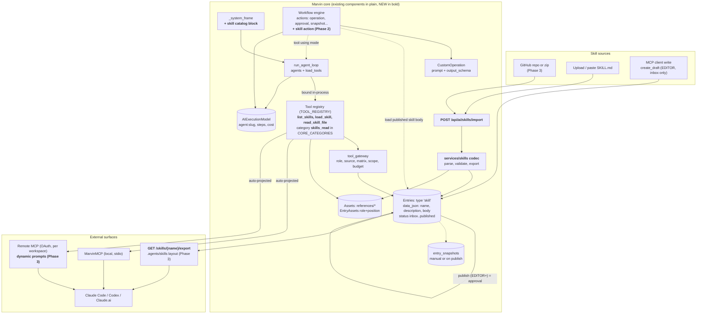

# Marvin Agent Skills: codebase gap analysis

Research only, 2026-10-21. Nothing was implemented. Prompt: `~/brain/00-Inbox/Marvin Agent Skills Gap Analysis Prompt.md`.
Core repo at `develop` (3aafbc67). Sibling repos read: MarvinMCP, MarvinSDK, MarvinCLI, MarvinIntegrationSDK.
Paths are relative to `~/code/Marvin/src/marvin/` unless a repo is named. `file:line` was checked on 2026-10-21. Anything not verified is marked **Unknown**.

Status vocabulary used in the matrix:
- **Exists**: works today for this purpose.
- **Partial**: some of it works, with a named gap.
- **Reusable**: an existing component hosts it with configuration or a small extension.
- **Missing**: nothing to build on.
- **Unknown**: not verified.

---

## 1. Executive summary and recommendation

**How much of Agent Skills does Marvin already have?**
- The plumbing is mostly there. The skill concept is absent.
- No SKILL.md parser or serializer exists. Marvin has no skill catalog and no activation tool. There is no package format and no skill-aware workflow step.
- A repo-wide search finds no implementation. The word "skill" appears only as an unrelated client-side slash-command registry (`frontend/src/lib/marvin/capabilities.ts:5`) and as a string in MarvinMCP's `futureArchitecture` list (`MarvinMCP/src/capabilities/meta/index.ts:41`).
- The storage, authorization, tool-projection and execution-history layers that a skills system needs are already built and audited. Roughly 70% of the work is configuration plus one parser. The remaining 30% is the catalog, activation and packaging code that does not exist yet.

**Recommendation: no new subsystem.**
1. A skill is an **Entry** of a `skill` entry type, with its reference files as attached text **Assets**.
   - The type is created lazily and non-publishable, the way Social creates its rule type (`services/integrations/social_setup.py:90`).
   - That gives status lifecycle, schema validation, snapshots, permissions, trash, backup, collections and tags for free.
2. Add three **registry tools**: `list_skills`, `load_skill` and `read_skill_file`.
   - The registry is the single source of truth (`services/ai/tools/base.py:89`).
   - Both MCP surfaces and the in-process agent pick up new tools with no per-tool wiring.
   - One new category, `skills_read`, goes into `CORE_CATEGORIES` (`services/ai/agent.py:277`). Without it the tools hide behind `load_tools`.
3. Inject a short **catalog block** (name and description) into `_system_frame` (`routes/ai/operations_controller.py:1865`) when the agent has `load_skill`.
4. Add one small **SKILL.md codec** (parse, validate, export) plus import and export endpoints.
5. Phase 2 adds a `skill` **workflow action**. Phase 3 adds packaging, GitHub import and MCP prompts for external agents.

**Minimal change set that makes it coherent, portable and secure:**
- One module (`services/skills/`): codec, validator, GitHub fetcher.
- One entry-type payload.
- Three tools plus one category line.
- One prompt-frame paragraph.
- Two endpoints.
- Phase 2 and 3 additions, each of similar size.
- **No new tables, no runtime, no service.** Phase 1 needs no migration.

**Biggest honest caveat.** The recommended agent flow is read-only instruction loading. The spec's `scripts/` is not supported, deliberately (section 9). A skill that only works when it can run `scripts/extract.py` loads fine but cannot do its job in Marvin. The `compatibility` field is the right place to say so.

---

## 2. Codebase inventory (source paths and symbols)

### 2.1 Content model (where a skill would live)

| Concern | Evidence |
|---|---|
| Entries | `db/models/platform/entries.py:27` `Entries`: `title`, `slug`, `data_json` (typed fields), `status` (inbox, draft, needs_review, approved, published, archived), `metadata_json`, `suggestion_json` (staged AI changes). Entries have no version column. |
| Entry types and field schema | `db/models/platform/entry_types.py:17` `EntryTypes`: `schema_json`, `capabilities_json`, `recipe_json`, `page_url_pattern`. Field kinds are in `schemas/platform/entry_type_schema.py`: text, textarea, markdown, number, boolean, select, date, datetime, json, embed, asset, asset-list, resource, resource-list. Text fields take `min`, `max` and `pattern`. |
| Workspace-owned internal types | `capabilities_json.publishable:false` keeps a type off the public API (`services/publish_visibility.py:5`). `listed:false` keeps it out of lists, search and the AI index (`services/entry_listing.py:31`). Precedent: `services/integrations/social_setup.py:90` `RULE_TYPE_PAYLOAD`. |
| Assets (files) | `db/models/platform/assets.py` has `mime_type`, `asset_type`, `checksum`, `storage_key`, `scope`, and `metadata_json`. Markdown maps to `document` (`services/assets/metadata_extractor.py:65`). Upload types can be restricted by `ASSET_ALLOWED_MIME_TYPES` (`core/settings/settings.py:655`). |
| Entry-asset junction | `db/models/platform/entry_assets.py:17` `EntryAssets` has `position`, `role` (free string) and `metadata_json`. The `attach_asset` tool accepts `role` but not `metadata_json` (`services/ai/tools/builtins_actions.py:330`). |
| Resources | `db/models/platform/resources.py`: flat columns (`resource_type`, `url`, `external_id`, `metadata_json`). It has **no status, no schema, no snapshots**. |
| Collections and tags | `db/models/platform/collections.py`, `tags.py`. Smart collections are declarative (`services/collections/smart_collections.py`). |
| Versions | `db/models/platform/entry_snapshots.py` `EntrySnapshotModel`. `services/snapshots.py:34` `MAX_PER_ENTRY = 20`. They are **manual or workflow-captured**, not on every save. Routes have diff and restore (`routes/platform/entry_snapshots_controller.py:33-83`). |
| Export | `routes/platform/workspace_controller.py:38` `export_workspace` exports the whole workspace as JSON. There is no per-entry or per-skill package. |
| Blueprints | `schemas/platform/blueprints.py:21` `BlueprintKind` includes `entry_type`. Applying a blueprint creates what is missing and never overwrites (`services/blueprints/apply.py`). |
| Search | Semantic index covers published, listed entries, resources and assets (`services/ai/embeddings_registry.py:93-141`). `find_entries` is a rich structured filter (`services/ai/tools/builtins.py:258`). |
| Guarded HTTP | `services/integrations/http_client.py` (public hosts only, redirects re-checked, size cap), used by `services/automation/actions/fetch.py`. |

### 2.2 Agents and tools

| Concern | Evidence |
|---|---|
| Agent definition | `db/models/groups/agents.py:22` `WorkspaceAgentModel`: `system_prompt`, `tool_allowlist`, `tool_policy`, `min_role`, `sources`, `allow_writes`. Spec: `services/ai/agents.py:254` `AgentSpec`. System agents `marvin`, `ask`, `builder`, `chat` are code. |
| Instructions are one blob | `routes/ai/operations_controller.py:1855` `_named_agent_instructions` returns `spec.system_prompt` or a default. `_system_frame` (line 1865) wraps it with `workspace_preamble` (`services/ai/agents.py:182`) and a roster. There is **no per-turn instruction loading**. |
| Tool registry | `services/ai/tools/base.py:56` `ToolSpec` (`name`, `input_schema`, `handler`, `min_role`, `sources`, `read_only`, `uses_ai`, `bulk_write`, `ask_first`). `register_tool` and `TOOL_REGISTRY` follow. |
| Tool categories and matrix | `services/ai/tools/categories.py:64` `CATEGORY_BY_TOOL`. Unknown tools fall back to `other_read` or `other_write` (`category_of`, line 126). Policy: `services/ai/agents.py:583` `default_policy` and `:608` `resolve_policy`. |
| On-demand loading | `services/ai/agent.py:277` `CORE_CATEGORIES` and `:281` `split_on_demand`. The `load_tools` tool loads **tool categories**, not instructions. The loop is `run_agent_loop` (`agent.py:356`). |
| Binding tools | `routes/ai/operations_controller.py:2709` `_bind_agent_tools`: registry tools, then AI operations, then allowlisted external MCP tools. |
| Stateless agent runner | `services/ai/tools/builtins_agents.py:174` `_run_standalone`: a service-layer agent run that writes an `AIExecutionModel` row. `standalone_tools` is at `:137`. Controller runs are at `operations_controller.py:1194` `run_named_agent`. |
| Docs as loadable instructions | `services/ai/tools/builtins_docs.py:52` `search_docs` and `read_doc`. `services/docs.py:533` `_with_guides` injects plugin-shipped markdown guides into the same index. |
| Document reading | `services/ai/tools/builtins_attachments.py:82` `read_attachment` reads a library asset's text (txt, md, json, yaml, pdf, docx), capped at 20,000 characters. |
| Authoring | `services/ai/tools/builtins_authoring.py:175` `create_draft` (EDITOR, always inbox) and `:224` `update_draft` (refuses published or approved entries). |
| Execution history | `db/models/groups/ai_executions.py` `AIExecutionModel`: `operation_slug` (`agent:<slug>`), `input_json`, `output_json`, tokens, cost, `metadata_json` (parent link, `services/ai/executions.py:7`). Visibility: `services/ai/executions.py` `visible_runs`. |

### 2.3 Workflows

| Concern | Evidence |
|---|---|
| Action registry | `services/automation/actions/__init__.py` registers: automation_result, metric, schema_check, integration, approval, operation, snapshot, fetch, handler, entry, collect, parallel, email, wait, media, repeat, emit_event, webhook, request. **No agent or skill kind.** |
| Single-shot prompt step | `services/ai/operations/custom.py:65` `CustomOperation`: an inline `prompt` plus `output_schema` (max 20 properties, validated with one retry), run by `services/automation/runner.py:61` `run_operation_action`. The material is marked as data, never instructions. |
| Run inputs | `services/automation/inputs.py:22` `declared`: a manual trigger's typed inputs, read as `${input.x}`. |
| Approvals | `services/automation/actions/approval.py:19`, `services/automation/approvals.py`. |
| Agent triggers a workflow | `services/ai/tools/builtins.py:886` `run_workflow` (ADMIN, recorded like the Run button). |
| Workflow recipes | `services/automation/recipes/` (about 140 JSON recipes plus `catalogue.json`), `services/automation/library.py` (`{{setup}}` placeholders). Plugins add recipes and a markdown `guide` (`MarvinIntegrationSDK/src/marvin_integration_sdk/recipes.py`, `base.py:249`). |
| Agent loop only from controller and tool | `run_agent_loop` is called only from `operations_controller.py` and `builtins_agents.py:243`. **Workflows cannot run an agent today.** |

### 2.4 MCP, SDK, CLI, UI

| Concern | Evidence |
|---|---|
| Shared gate | `services/ai/tool_gateway.py:87` `visible_tools` and `:107` `invoke_unattended`. They apply role, invocation source, permission matrix, read-only scope, AI budget and bulk-write gate. Both MCP surfaces go through it. |
| Local MarvinMCP (sibling repo) | `MarvinMCP/src/capabilities/tools/index.ts` projects every registry tool from `GET /api/ai/tools` (`routes/ai/operations_controller.py:116`) as `marvin_<name>`. This happens at startup (`MarvinMCP/src/index.ts:28`). **Prompts are static TypeScript** (`registerPrompt` in each capability). |
| Remote MCP (in core) | `services/mcp_remote/server.py`: OAuth grant per user, per workspace, with read or write scope. `list_tools_for` is at `:139`. **Prompts are a hard-coded dict** (`PROMPTS`, `:418`) and resources a static dict (`RESOURCES`, `:496`), each backed by a read tool. `EXTRA_TOOLS` at `:47` shows how a tool is offered to remote MCP that withholds the `mcp` source. |
| SDK | `MarvinSDK/src/platform/ai/tools.ts` has `list`, `listAgent` and `invoke`. There is **no named-agents module**: `/api/ai/agents` exists only as generated schema, and the frontend says "not in the SDK yet" (`frontend/src/lib/api/aiAgents.ts:2`). |
| CLI | `MarvinCLI/src/commands/ai/` has operations, providers, settings. There is no agents or tools command. Workflows and entries have commands under `commands/platform/`. |
| Plugin SDK | `MarvinIntegrationSDK`: a provider declares `actions`, `recipes`, `guide` (markdown, up to 16 KiB). No skill concept. |
| Frontend | Schema-driven entry editor (`frontend/src/components/SchemaForm.astro`, `SchemaEditor.astro`). Agent settings at `frontend/src/pages/workspace/settings/ai-agents.astro`. Workflow library at `pages/automation/library.astro`. **No skills UI.** |

---

## 3. Capability gap matrix

| # | Capability | Status | Evidence | Gap | Approach | Effort |
|---|---|---|---|---|---|---|
| 1 | Storage and metadata | **Reusable** | `Entries` with a workspace entry type (`entry_types.py:17`), `EntryAssets` for files, tags and collections | No `skill` type, no field definitions, no seed | Lazy-create an internal `skill` entry type with fields `name`, `description`, `body` (markdown, `autoEmbed:false`), `license`, `compatibility`, `allowed_tools`, `metadata` (json) | 1-2 days |
| 2 | SKILL.md and GitHub import | **Missing** | Nothing parses frontmatter. `fetch` action and the guarded HTTP client could fetch (`actions/fetch.py`, `integrations/http_client.py`) | Parser, validator, directory-to-entry-plus-assets mapper, GitHub tree fetcher | New `services/skills/` codec. Import via `POST /api/ai/skills/import` (body or URL). Lenient parse per the upstream client guide | 4-6 days (GitHub fetch 2 more) |
| 3 | Search, discovery, dynamic loading | **Partial** | `find_entries` (filter by type, status, fields, `include_fields`) and `get_entry` already act as list and load. `read_attachment` loads references. `search_docs` and `read_doc` are the same pattern for the manual | No catalog in the prompt, so the model is not told skills exist. `load_tools` loads tool categories only. Generic tools need entry-type knowledge | `list_skills`, `load_skill`, `read_skill_file`, category `skills_read` in `CORE_CATEGORIES`, catalog paragraph in `_system_frame` | 3-4 days |
| 4a | Agent invocation | **Partial** | An agent's `system_prompt` and `tool_allowlist` exist. `run_agent` and `_run_standalone` run an agent with history | No skill binding or activation. No per-agent skill allow-list | Phase 1: skills visible to any agent that is allowed `load_skill`. Phase 2: optional `skills` column on `WorkspaceAgentModel` (one migration) | Phase 1 free; column 1 day |
| 4b | Workflow action | **Missing** (partial neighbour) | `custom` operation is a single-shot prompt plus validated `output_schema` (`custom.py`). `run_workflow` tool lets an agent start a workflow | No `skill` or `agent` action kind. Tool-using skills need an agent loop outside the controller | Phase 2: `skill` action kind. First as instruction-only single shot built on `CustomOperation`. Later tool-using, via `_run_standalone` extracted to a service | 4-6 days (+4 for tool-using) |
| 5 | MCP exposure | **Partial** | Registry tools project automatically to local and remote MCP (`tools/index.ts`, `server.py:139`) | Prompts are static in both MCP servers, so external clients cannot list workspace skills as prompts. Local tool list is read at startup | Tools: free. Prompts: make `server.py` `list_prompts` and `get_prompt` dynamic (one connection-scoped query). Local MarvinMCP: same, in TS | Remote 2 days; local 2 days |
| 6 | Authorization and workspace isolation | **Exists** (Reusable for skills) | Role floors, source policy, matrix, read-only scope and budget in `tool_gateway.py`. Entry edit rules: AUTHOR edits only own, non-approved entries; EDITOR or above approves and publishes (`routes/_base/checks.py:236-275`). OAuth grant pinned to one workspace | Skills inherit it. Only addition: `load_skill` must filter by `status == published` and workspace | Handler filters. Reuse `ToolContext.group_id` scoping. Add a cross-workspace test | 1 day (tests) |
| 7 | Versioning and validation | **Partial** | Field-level validation on entries. Snapshots with diff and restore, but manual, max 20, no version number | No SKILL.md spec validator. No pinning. Snapshots are not taken on publish | Validator in the codec (spec constraints). `metadata.version` string. Capture a snapshot on `entry_published` with a workflow recipe (`snapshot` action exists). Pin by snapshot id or content hash | Validator 1-2 days; snapshot-on-publish 1 day; pinning 2-3 days (Phase 3) |
| 8 | Export and publishing | **Missing** | Workspace JSON export only (`workspace_controller.py:38`). `publishable:false` keeps it off the public API | No per-skill export, no zip, no public registry, no GitHub publish | `GET /api/ai/skills/{slug}/export` returns a zip of `SKILL.md` plus files. Public or private distribution is a Phase 3 decision (section 8) | 3 days |
| 9 | Execution history and structured results | **Partial** | `AIExecutionModel` records agent runs, tool steps in `output_json`, parent links, cost. `custom` op validates `output_schema` | Activation is not recorded as a first-class fact. No skill name on the row | Record `load_skill` calls in the existing step trace (free) and stamp `metadata_json.skills=[...]` on the execution. Workflow action output reuses `$previous` | 1-2 days |
| 10 | Optional script execution | **Missing**, recommended to stay missing | No sandbox. Subprocess use is limited to PDF reading and a render screenshot (`services/ai/media/documents.py`, `render.py`) | Arbitrary code execution is a different product | Do not build. Advertise via `compatibility`. See section 9 | n/a |

Cross-checks that shaped the matrix:
- `update_draft` refuses published or approved entries (`builtins_authoring.py:224`). An agent cannot silently rewrite a live skill.
- Remote MCP refuses nothing about skills yet because it knows nothing about them. The gate is correct by inheritance.
- Docs-on-demand (`search_docs`, `read_doc`) is the strongest evidence that the pattern already works at the product level.

---

## 4. Upstream comparison

### 4.1 Required by the open spec (agentskills.io/specification, fetched 2026-10-21)

- A directory containing `SKILL.md`, with YAML frontmatter then a markdown body.
- `name`: required, 1-64 characters, lowercase letters, digits and hyphens, no leading, trailing or double hyphen, must match the parent directory name.
- `description`: required, 1-1024 characters, says what it does and when to use it.

### 4.2 Optional in the spec

- `license`.
- `compatibility` (1-500 characters).
- `metadata` (string-to-string map).
- `allowed-tools` (space-separated string, marked experimental).
- Conventional directories `scripts/`, `references/`, `assets/`.
- Guidance: catalog about 100 tokens per skill, body under about 5,000 tokens or 500 lines, references one level deep.

### 4.3 Client guidance (adding-skills-support, not normative)

- Three tiers: catalog, then full body on activation, then resources on demand.
- Activation by file read or by a dedicated tool. A dedicated tool is the right choice for a hosted agent. Constrain the name as an enum, and hide skills the caller cannot use.
- Wrap activated content in tags, list bundled resources without reading them, deduplicate activations, and protect skill content from compaction.
- Lenient validation: warn on a name mismatch, skip only when the description is missing or the YAML is unparseable.
- Gate project-level skills on trust.
- Precedence: project over user.
- `.agents/skills/` is a cross-client directory convention. The spec does not mandate locations.

### 4.4 Host-specific (not portable)

Claude Code adds frontmatter fields: `when_to_use`, `argument-hint`, `arguments`, `disable-model-invocation`, `user-invocable`, `disallowed-tools`, `model`, `effort`, `context: fork`, `agent`, `hooks`, `paths`, `shell`. It also adds `$ARGUMENTS` substitution and `` !`cmd` `` shell injection. Per Claude's docs, a skill uploaded to claude.ai fails if it includes those fields. Codex uses `agents/openai.yaml`. Marvin should **preserve unknown frontmatter on import and round-trip it on export, and never act on it.** Specifically, never execute `` !`cmd` `` injection.

### 4.5 Matt Pocock's repo (`mattpocock-skills` 1.3.1, local copy)

Conventions, not requirements:
- Skills are bucketed (`engineering/`, `productivity/`, `misc/`, `in-progress/`, `deprecated/`) and listed in `.claude-plugin/plugin.json`.
- Skills use sibling files by relative link (`tdd/tests.md`, `mocking.md`).
- Skills call other skills with explicit "call the Skill tool with X" text (`.agents/invocation.md`).
- Invocation is split into model-invoked and user-invoked, using `disable-model-invocation`.
- Descriptions are written as trigger phrases ("Use when the user wants...").
- Versioning is changesets plus a plugin version.
- The repo documents what it refuses (`.out-of-scope/`), including "harness should stop subagent recursion, not skills".

Lessons for Marvin:
- Cross-skill calls must go through a tool Marvin controls, not prose.
- A user-invoked flag has a clean meaning in Marvin: exclude the skill from the model catalog, expose it as an MCP prompt or Run button only.
- Skills are written for a coding harness. Many assume file access, subagents and a question tool. Marvin cannot honor those assumptions, so `compatibility` plus an import-time warning is the honest answer.

### 4.6 A2A is a different thing

A2A Agent Cards advertise a `skills` array describing what a remote agent can do (confirmed that skills are part of the card; field-level details **Unknown**, the spec page was truncated). That is an externally advertised **capability**, not instructions. See section 9 and the Brain note [[Agent Capability Directory PoC]]. Do not reuse the word "skill" for both without a prefix in the UI.

---

## 5. Architecture decision and alternatives

### 5.1 Model options

| Option | For | Against | Verdict |
|---|---|---|---|
| **A. Dedicated `skills` table and service** | Exact shape, spec-aligned | New model, migration, repository, controller, trash, backup, export, UI, permissions, tests: everything entries already have. Duplicates the status lifecycle | Reject |
| **B. Specialized Resource** (`resource_type: skill`) | Resources are reusable and linkable | No status (`resources.py` has none), no schema validation, no snapshots, no approval gate. `metadata_json` is untyped. Resources exist to be referenced by entries, not to be governed content | Reject |
| **C. Content type only** (entry type, assets as loose files) | No code | Needs a parser anyway. The file mapping is ad hoc | Subsumed by D |
| **D. Hybrid: entry (metadata, body, lifecycle) plus assets (files)** | Reuses every governance, audit, UI and backup path. Matches the Social precedent (`social_setup.py`, publishing a rule approves it). The spec's body is markdown, which the markdown field handles | Entries have no version column. Reference files are flat assets with no directory structure | **Recommended** |

### 5.2 Concrete mapping (Option D)

- `name`: text field, pattern `^[a-z0-9]+(-[a-z0-9]+)*$`, max 64. Entry `slug` equals `name`.
- `description`: text field, max 1024, required.
- `body`: markdown field with `autoEmbed:false`. This stops media links in the instructions turning into players (`MarkdownFieldSchema.auto_embed`).
- `license`, `compatibility` (max 500): text fields.
- `allowed_tools`: text field, kept verbatim.
- `metadata`: json field. `metadata.version` is the skill version.
- `extra_frontmatter`: json field, round-trips host-specific keys unchanged.
- `user_invocable` and `model_invocable` booleans (Marvin-specific, not in the spec): control catalog visibility.
- `references`: asset-list. Each linked asset has `EntryAssets.role` plus a relative path.
- Entry type capabilities: `publishable:false` (never served to the public site). `listed` is an open decision (section 8).
- **Lifecycle:** `published` means loadable. `draft`, `inbox`, `needs_review`, `approved`, `archived` do not load.

Reference path handling: the junction has `metadata_json`, but `attach_asset` only sets `role` (`builtins_actions.py:330`). Phase 1 options are asset `name` equals the relative path (`references/REFERENCE.md`) or `role` equals the path. Prefer the asset `name`: it shows in the existing assets UI.

### 5.3 Is a new runtime needed? No.

- Instruction skills need only an extension to the existing loop: a tool that returns text (`load_skill`) and a catalog in the prompt. The loop already loads tools on demand and runs tools unattended (`agent.py`, `tool_gateway.py`).
- Skills do not need their own execution engine. Tool use stays under the agent's matrix (`resolve_policy`). Cost and history stay in `AIExecutionModel`.
- For workflows, Phase 2 adds one action kind next to `operation`. Retries, approvals, history, schedules, webhooks, parallelism and `wait` already exist (`services/automation/engine.py`, `actions/`).

### 5.4 Where search_skills, list_skills and load_skill live

**Shared registry tools** (`services/ai/tools/builtins_skills.py`), backed by one service module `services/skills/` that the REST routes also call.
- **Why not MCP-only or API-only:** a registry tool is bound in-process by the agent, projected to local MarvinMCP and remote MCP, and callable from the REST invoke endpoint, all with the same gates. Putting it anywhere else duplicates the permission logic.
- **Do not add `search_skills`.** `list_skills(query?, tag?)` over name and description is enough for tens of skills. `search_content` already searches published, listed entries semantically if a skills type is listed.
- `list_skills` returns only `{name, description, compatibility, user_invocable}`. `load_skill(name)` returns the body wrapped in `<skill_content name=...>` plus a resource listing. `read_skill_file(skill, path)` delegates to the `read_attachment` logic (`builtins_attachments.py:82`), scoped to the skill's attached assets.
- All three: `read_only=True`, `min_role=VIEWER`, category `skills_read` (not a write category), added to `CORE_CATEGORIES`.

### 5.5 What export, distribution and pinning need

- **Package export:** a codec serializing the entry to `SKILL.md` (frontmatter plus body) and the linked assets to relative paths, zipped. This is the only genuinely new code besides import.
- **Workspace-scoped discovery:** already inherent. The remote MCP grant pins one workspace (`services/mcp_remote/oauth.py`).
- **Private distribution:** export the zip, or reach it over authenticated MCP.
- **Public distribution:** needs a decision. The simplest compliant path is "export to a git repo layout and let GitHub host it". Marvin acting as a public registry is a new product surface with its own abuse model.
- **Version pinning:** needs a stable identifier. Options are `metadata.version`, a snapshot id, or a content hash. Phase 3. Note that snapshots cap at 20 per entry and are lost with the entry (`entry_snapshots.py`).

---

## 6. Integration design

### 6.1 Agents

- **Catalog:** when the run's tool set includes `load_skill`, `_system_frame` appends a labelled block: instructions ("when a task matches a description, call `load_skill`") and a list of `name: description` for published, model-invocable skills the caller may see. Omit it entirely when there are none (the upstream guide recommends this). Cap at, say, 50 skills and 100 tokens each, and say so in the preview.
- **Prompt preview:** `routes/ai/operations_controller.py` `_prompt_preview` should show the catalog part, labelled, like the roster.
- **Activation:** `load_skill` returns text as a tool result. Dedupe within a run (return a short "already loaded" note).
- **Compaction:** Marvin's loop has no compaction step. **Unknown** whether the Ask page threads truncate old tool results. Check `services/ai/threads.py` before relying on this.
- **Permissions:** a skill never grants anything. `allowed_tools` is advisory text in Phase 1. In Phase 2 it can only intersect with the agent's matrix, never widen it. Marvin's rule already is "an agent cannot do more than the user it works for" (`resolve_policy` docstring).
- **Optional per-agent binding:** a `skills` JSON column on `WorkspaceAgentModel` (null = all published). One migration. Defer until a real need appears.
- **Tool-count budget:** adding three tools to `CORE_CATEGORIES` is cheap. The existing on-demand design exists because about 50 tool definitions dominate the prompt (`agent.py:274` comment).

### 6.2 Workflows (Phase 2)

- New action kind `skill`: `{"kind":"skill","skill":"name","input":{...},"output_schema":{...}}`.
- **Instruction-only mode (cheap):** build a `CustomOperation` whose prompt is the skill body plus the interpolated input, with the step's `output_schema`. This reuses the budget gate, execution log, retry-once-on-schema-mismatch and `${...}` templating. No new runtime.
- **Tool-using mode (later):** run the skill as a stateless agent run. This needs `_run_standalone` (`builtins_agents.py:174`) lifted into a service function callable from the engine, plus a policy for "ask first" in an unattended workflow (the loop parks, a workflow cannot). The existing `approval` action is the human gate.
- Why not a Python-level skill runner: workflows already have approvals, retries, history, idempotency and dry-run (`engine.py`, `recorder.py`, `idempotency.py`). A second engine would diverge.
- Skills also need a stated relationship to workflow recipes: a recipe is orchestration (steps and triggers). A skill is guidance. A skill may **tell** an agent to call `run_workflow`. A workflow recipe may **call** a skill step. They never share a table.
- Dry-run: the `skill` action must resolve the skill and validate inputs without calling the model, like `operation` does (`runner.py` dry-run branch).

### 6.3 MCP

- Tools: `list_skills`, `load_skill`, `read_skill_file` appear on the local MarvinMCP (as `marvin_list_skills`, ...) and on remote MCP with no code change, subject to `sources` containing `mcp`.
- Prompts: Phase 3 makes `list_prompts` and `get_prompt` merge the static prompts with the workspace's skills that are `user_invocable`. Argument handling is the only design point: spec skills have none, Claude Code adds `arguments`.
- Resources: optionally expose `marvin://skills/{name}` through the existing `TEMPLATES` mechanism (`server.py:496-510`), served by `load_skill`.
- External clients (Claude Code, Codex) already read skills from disk. For them the better integration is **export to a `.agents/skills/` layout**, not MCP. MCP delivers skills to clients that have no filesystem.

### 6.4 SDK, CLI

- SDK: add `platform.ai.skills` (`list`, `get`, `import`, `export`). The SDK has no named-agents module at all today, so this follows the generated-schema path.
- CLI: `marvin skills import <path|url>`, `marvin skills export <name> -o dir`, `marvin skills validate <dir>`. `validate` can share the codec through the REST endpoint. Do not port the validator to TypeScript.

### 6.5 UI

- Entry editor: the schema-driven form works for a `skill` type with no change (`SchemaForm.astro`).
- Needed: an "Import skill" button (upload or GitHub URL) and a validation result panel. That is one page or dialog.
- Agents settings: nothing in Phase 1. Optionally a "Skills" checkbox group once the column exists.

---

## 7. Security assessment

Marvin's existing posture (role floors, deny-by-default external MCP, matrix, approvals, drafts) covers most of the surface. The new risks are specific to treating stored text as instructions.

| Threat | Today | Exposure with skills | Mitigation |
|---|---|---|---|
| **Prompt injection via skill body** | `custom` op marks material as data (`custom.py`). Tool results are model input | A skill body is *trusted instruction* by design. Anyone who can publish one steers every agent that loads it | Load only `published` skills (EDITOR or above sets that, `checks.py:236-275`). Show the catalog and body in the prompt preview. Wrap in tags so the model can tell skill text from user text |
| **Malicious or poisoned imported skill** | n/a | GitHub or zip import brings third-party instructions | Import lands as `inbox`. Never auto-publish. Show a diff and the full text before approval. Flag `` !`...` `` shell-injection syntax and `scripts/` presence on import |
| **Agent writes a skill that later runs privileged** | `create_draft` writes inbox only (EDITOR). `update_draft` refuses published or approved (`builtins_authoring.py:224`) | An agent can stage a malicious draft that a tired human publishes | Same review gate. `revise_entry` on a published entry: **Unknown** whether it stages or overwrites, check before launch |
| **Unexpected tool use** | Matrix, source policy, ask-first, read-only scopes (`tool_gateway.py`) | A skill says "delete everything" | Skills never alter the matrix. `allowed_tools` is advisory or intersect-only. Trash and archive on published entries already ask first |
| **Secrets in skills** | Workspace secrets referenced as `{{API_KEY}}` and resolved at run time (`services/secrets/`) | Authors paste keys into a markdown body, which is then in prompts, backups, exports and the semantic index | Importer scans for key-like strings. Document the `{{SECRET}}` reference convention. Skills must not resolve `{{...}}` themselves. Never put secret values in `metadata` |
| **Cross-workspace leak** | `group_id` on every query, grant pinned to one workspace. Working notes record a past bug where `ctx.group_id` was a `str` and a UUID comparison silently dropped rows (`Marvin — working notes`, line 79; not re-verified in code) | A `load_skill` that compares ids naively could miss or leak | Compare ids as strings like `user_role` does (`tools/base.py`). Add a two-workspace test: workspace B cannot list or load A's skill by name |
| **Supply chain** | Plugins are installed by admin (`plugin_loader.py`) | Skill packages from GitHub are mutable | Import by commit sha, record source URL and sha in `metadata`. Never track a branch. No auto-update |
| **Script execution** | None (no sandbox) | A skill says "run scripts/x.py" | Not supported. Show `compatibility` plus a warning. Never execute |
| **Shell-injection syntax** | n/a | Claude Code's `` !`cmd` `` appears in imported skills | Treat as plain text. Warn |
| **Approvals** | Agent loop parks asks; workflows have `approval` | A tool-using skill step in an unattended workflow cannot ask | Phase 2 instruction-only first. For tool-using, use the `approval` action as an explicit gate |
| **Context bloat or DoS** | Output caps on tools (`read_attachment` 20,000) | Huge bodies, hundreds of skills | Cap body (for example 20,000 characters), catalog (for example 50 entries), file size. Return `truncated:true` |
| **Info disclosure via catalog** | n/a | A catalog lists names an `ask` agent should not know | Catalog is filtered by the agent's tool policy (agent needs `load_skill`) and by role |
| **Audit** | `AIExecutionModel` plus event log | Who loaded which version, when | Stamp skill name and content hash in the execution `metadata_json` |

---

## 8. Open product and architecture decisions

1. **`listed:true` or `false` for the skill entry type?**
   - `false`: hidden from content lists and search, like Social rules. Cleaner for "internal" content, but `search_content` cannot surface skills and the user must reach them from a dedicated page.
   - `true`: skills appear next to normal content, in the semantic index, and in All entries.
   - My lean: `true` with `publishable:false`. It keeps the generic UI, search and the Brain-style workflow working. Needs your call.
2. **Reference file layout.** Flat assets named with relative paths, or a new junction field for the path? Phase 1 uses asset names.
3. **Who may author and publish?** EDITOR or above publishes today. Is that the right bar for instructions that steer agents, or should it be ADMIN?
4. **Per-agent skill binding in Phase 1?** Or wait until a real need.
5. **Naming.** "Skill" collides with the bubble's client-side slash-command registry (`capabilities.ts`) and the pet-skill reference in the character kit. Rename or prefix the UI ("Agent skills").
6. **Public distribution.** Export-only, GitHub-as-registry, or a Marvin-hosted catalog (new product surface, new abuse model)?
7. **Pinning and updates.** Pin by sha plus content hash? Auto-update from upstream, or always manual?
8. **`allowed-tools`.** Advisory text, intersect-only enforcement, or ignored? It is experimental upstream.
9. **User-invoked skills.** Marvin has no slash-command surface except the bubble. Is user-invocation (Run button, MCP prompt) in scope?
10. **Agent-authored skills.** Should an agent be able to draft a skill (a natural fit for `create_draft`), given the poisoning path above?
11. **A2A relationship.** Is "externally advertised agent capability" (Agent Capability Directory PoC) a goal here, or a separate project? This analysis keeps them separate.

---

## 9. Anti-goals and things not worth building

- **A skills table, service or microservice.** Entries do all of it.
- **A skill runtime or second agent engine.** `run_agent_loop` and the workflow engine suffice.
- **Arbitrary script execution** (`scripts/`). A sandbox is a product of its own, and Marvin's tool model already covers "operations" with a reviewed, role-gated set. If a skill needs code, make it a registry tool or an integration action, both of which have review, roles and history.
- **A skill marketplace or ratings.** Premature.
- **Auto-update from GitHub.** Supply-chain risk for no benefit at this scale.
- **A TS port of the validator.** Call the API.
- **A `search_skills` semantic tool.** `list_skills` over a small catalog is enough, and `search_content` already exists if the type is listed.
- **Trigger matching in the harness.** Upstream clients rely on model judgment from the description. Do the same.
- **Honoring host-specific frontmatter** (`context: fork`, `hooks`, `` !`cmd` ``). Preserve and ignore.
- **Merging "skill" and "A2A capability" into one concept.** Different consumers, different trust model.
- **Reimplementing `load_tools` for skills.** It loads tool categories. Skill loading is a plain tool call.

---

## 10. Smallest useful vertical slice

Goal: import a real instruction-only SKILL.md, store it, have an existing agent discover and load it, use its existing authorized tools, and leave an observable result. No migration, no UI beyond what exists.

1. **Entry type.** Create the `skill` entry type through the existing entry-type API or a blueprint (`entry_type` kind), with the fields in section 5.2 and `publishable:false`. (For the slice, doing this by hand in the UI is acceptable, and a lazy-create helper follows Social's pattern.)
2. **Codec.** `services/skills/codec.py`: `parse_skill_md(text) -> (frontmatter, body, problems)` with the lenient rules from the upstream guide. Reuse `jsonschema` or Pydantic, already dependencies. About 100 lines plus tests.
3. **Import.** `POST /api/ai/skills/import` with a SKILL.md body: parse, validate, create an `inbox` entry through the existing entry write path. A human publishes it in the normal editor.
4. **Tools.** `builtins_skills.py` with `list_skills` and `load_skill` (skip `read_skill_file` in the slice). Add `skills_read` to `categories.py` and to `CORE_CATEGORIES`. Register the import in `services/ai/tools/__init__.py`.
5. **Catalog.** One paragraph appended in `_system_frame` when `load_skill` is bound.
6. **Run it.** `POST /api/ai/agents/marvin/run` with a message the skill's description matches. Expect: `list_skills` or the catalog, a `load_skill` call, then existing tools (for example `find_entries`) per the skill's instructions, then an answer. Check the execution row (`/api/ai/executions`) for the step trace.

Test plan:
- Unit: codec (valid, no description, bad name, unparseable YAML, extra host keys round-tripped).
- Tool: draft skill is not loadable, published is. Cross-workspace isolation. Read-only connection can run `load_skill`.
- Agent: fake-provider loop test in the style of `tests/test_agent_loop.py`, asserting the tool call order. Run the full backend suite (working notes: an agent-loop change needs the full suite, and a new `run_agent_loop` kwarg breaks the test fakes).
- MCP: `tests/test_remote_mcp_server.py` style check that the tools are listed and gated.

Rough effort: 5-8 days including tests.

---

## 11. Phased roadmap

### Phase 1: instruction skills end to end (about 2 weeks)

| Item | Detail |
|---|---|
| Dependencies | None beyond current develop. |
| Migrations | **None.** The entry type is data. (A lazy-create helper, not a schema change.) |
| API | `POST /api/ai/skills/import` (SKILL.md text; optional zip later), `GET /api/ai/skills` (list), `POST /api/ai/skills/validate`. |
| Tools | `list_skills`, `load_skill`, `read_skill_file`. Category `skills_read` in `CORE_CATEGORIES`. |
| Prompt | Catalog block in `_system_frame` plus a line in `_prompt_preview`. |
| SDK, MCP, CLI | Tools reach MCP automatically. SDK `platform.ai.skills` (list, import, validate). CLI `skills validate` and `import`. |
| UI | Import dialog and validation panel. Entry editor needs nothing. Optional: skills list under Settings → AI. |
| Tests | As section 10, plus codec fuzz cases, body caps, and the type being non-publishable (`is_publishable_type`). |
| Risks | Catalog bloat. The model ignoring the catalog. Naming collision. The `listed` decision. Agents that assume `scripts/`. |
| Effort | 8-12 days. |

### Phase 2: workflow skill action (about 2 weeks)

| Item | Detail |
|---|---|
| Dependencies | Phase 1. A decision on tool-using mode. |
| Migrations | Optional `skills` column on `WorkspaceAgentModel`. None otherwise. |
| Engine | New action kind `skill` in `services/automation/actions/`. Instruction-only version on `CustomOperation`. Dry-run branch. Add to the builder's available kinds and to `validation.py` and the authoring guide (`services/automation/authoring.py`). |
| Tool-using mode | Lift `_run_standalone` into a service function. Decide unattended ask-first behavior. |
| Approvals, retries, history | Inherited from the engine. Output typed by `output_schema`. |
| Permissions | Definer's rights like `operation` (`runner.py` `require_role`). Skill must be published at run time and at save time. |
| API, UI | Workflow editor option for the `skill` step. Add a `skill` recipe or two to the library with a vars file. |
| Tests | Engine step tests, dry-run, a retry, an approval ahead of the step, a schema-mismatch retry. Recipe tests (`tests/test_workflow_library.py` is the existing pattern). |
| Risks | Prompt-only skills in workflows lack tools, so users may expect more. Budget accounting. |
| Effort | 8-12 days (tool-using adds about 4). |

### Phase 3: portability and external discovery (about 2-3 weeks)

| Item | Detail |
|---|---|
| Dependencies | Phases 1-2. Decisions 5, 6 and 7 in section 8. |
| Migrations | None expected. Possibly a `source_url` and `source_sha` convention in `metadata`. |
| Export | `GET /api/ai/skills/{name}/export` (zip) and a "bundle all published" export in an `.agents/skills/` layout. |
| GitHub import | Fetch a tree at a commit through the guarded HTTP client. Honor size and file-count caps. Lands as `inbox` with a diff. |
| Pinning | `metadata.version`, snapshot on publish (workflow recipe with the `snapshot` action), pin by snapshot id or content hash. |
| MCP | Dynamic `prompts/list` and `prompts/get` in `services/mcp_remote/server.py` and MarvinMCP. Optional `marvin://skills/{name}` resource. |
| UI | Source and version badges, update-available (manual) notice, export button. |
| Tests | Round-trip: import then export then diff. Pin stability. OAuth read-only grants see only loadable skills. Zip-slip and size-bomb cases. |
| Risks | Supply chain (decision 7). Spec drift (it is young, `allowed-tools` is experimental). Public distribution scope creep. |
| Effort | 10-15 days. |

---

## 12. Challenge the premise

**Where Marvin already makes a separate Skills subsystem redundant:**
- *Storage, lifecycle and governance* are Entries. A parallel store would re-implement drafts, review, publishing, trash, snapshots, backup, tags and collections.
- *Discovery and loading* already exist generically. `find_entries(entry_type, status, include_fields)` is a catalog query. `get_entry` is a load. `read_attachment` loads reference files. What is missing is a **named, discoverable contract and a prompt that tells the model it exists.** That is a few hundred lines.
- *Docs-on-demand* (`search_docs`, `read_doc`, plugin guides) already proves progressive disclosure in this product.
- *Authorization* is not a design question. The gateway, the matrix and the grant model already answer it. A skills system built outside it would be weaker.
- *Execution and history* are the existing agent loop and `AIExecutionModel`.
- *Workflows* already have a single-shot prompt step with a validated output. The "skill action" is mostly a different source for that prompt.

**Where the premise is stronger than the code suggests:**
- The loop cannot be called from a workflow at all today (`run_agent_loop` only from the controller and `run_agent`). Phase 2 tool-using skills therefore require extracting the loop, which is more than a new action kind.
- Marvin has no file system for agents, so most coding-harness skills (written for Claude Code or Codex) will import but only partly work.

**Where the premise may be weaker than the prompt assumes:**
- *Export and public distribution may not be worth building.* Claude Code and Codex read skills from disk. The cheapest portable path is a one-way export zip. Hosting a registry is a separate product.
- *External MCP discovery adds little for tools.* The registry already projects. The only real new thing is MCP prompts.
- *A2A and "skills" are different animals.* The Agent Capability Directory PoC should not be a driver here.
- *Is the audience actually Marvin's own agents?* The use case with clear value is "workspace owners write instructions that Marvin's agents and Claude (over MCP) follow." That is Phase 1 only. If nobody asks for Phase 3, stop at Phase 2.

---

## 13. Architecture diagram

Legend: skills are **instructions** (the `skill` entry). Tools are **operations** (the registry). Workflow recipes are **orchestration** (the engine). A2A agent capabilities are **externally advertised** and sit outside this picture.

---

## Appendix: what was not verified

- Whether the Ask page's thread storage truncates or summarizes old tool results (affects skill durability across a long conversation).
- `revise_entry` behavior on a published entry (stage versus overwrite).
- A2A `AgentSkill` field list (the spec page was truncated at 100,000 characters).
- Whether `ASSET_ALLOWED_MIME_TYPES` is set in any deployment (default is `None`, meaning no restriction in settings).
- The exact `ToolContext.group_id` str-versus-UUID behavior in current code (taken from the working notes).
- Frontend behavior of the entry editor with a markdown field above a size threshold.
- Trash behavior for a `skill` entry type that the catalog hides: not tested.
- Effort figures are order-of-magnitude, based on the size of comparable existing modules, not estimates from a spike.
